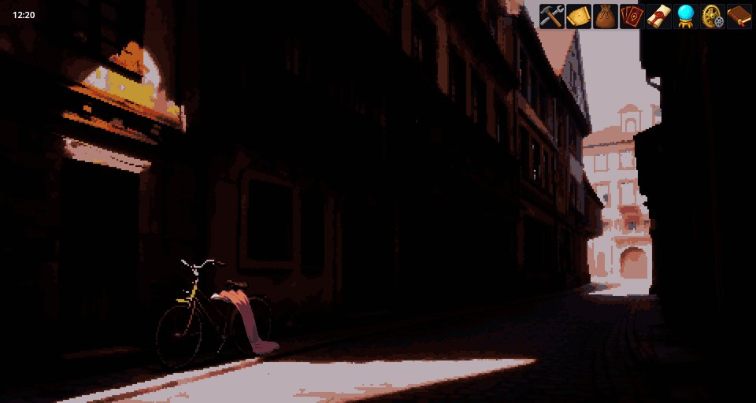
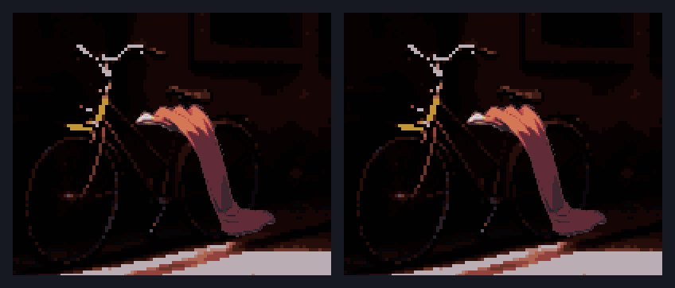
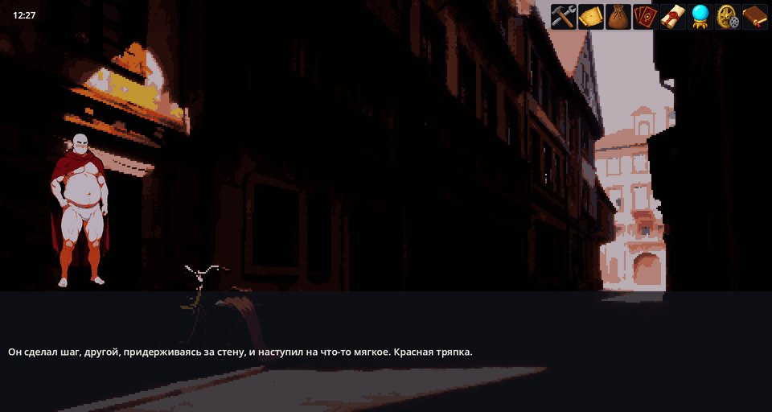

# Interactive Base — những thứ có thể nhấp trong cảnh

Interactive Base đưa các đối tượng có thể nhấp vào cảnh bằng hình ảnh: một vật nằm trên đất, một cánh cửa, một điểm "sau ngôi mộ đá". Đối tượng có thể có ảnh riêng vẽ đè lên nền, có thể sáng lên khi rê chuột, và một cú nhấp khởi chạy kịch bản. Kịch bản thêm và gỡ đối tượng theo tiến triển của câu chuyện.

Prologue của Cthangover dùng mod này. Bản đồ tile của RPG World dùng sự kiện riêng của mình thay thế.

## Trong game

Mở đầu Cthangover, trong con hẻm có một mảnh vải đỏ nằm cạnh chiếc xe đạp. Nó không phải một phần của nền: đó là một đối tượng tương tác có ảnh riêng.



Khi rê chuột lên mảnh vải, con trỏ biến thành hình bàn tay và mảnh vải ánh lên một sắc vàng nhạt:



Một cú nhấp khởi chạy kịch bản của mảnh vải: Marao nhặt nó lên, và kịch bản gỡ đối tượng khỏi cảnh.



## Một đối tượng tương tác

Các đối tượng là tệp JSON trong thư mục `interactives/` của mod. Đây chính là mảnh vải trong các hình trên (thuộc Cthangover), với phần viền đỉnh rút gọn:

```json
{
  "Items": [
    {
      "id": "cloak_ground",
      "texture": "cloak_ground",
      "layer": "foreground",
      "zIndex": 5,
      "cursor": "PointingHand",
      "hitArea": {
        "type": "polygon",
        "vertices": [
          { "x": 0.2796, "y": 0.7318 }, { "x": 0.3207, "y": 0.7167 },
          { "x": 0.3456, "y": 0.8434 }, { "x": 0.3387, "y": 0.8872 }
        ]
      },
      "highlight": { "color": "#FFD70044", "scale": 1, "duration": 0.12 },
      "actions": {
        "onClick": { "scenario": "scenarios/prolog/morning_cloak.scenario" }
      }
    }
  ]
}
```

- `texture` — một ảnh cỡ toàn màn hình, trong suốt trừ phần đối tượng, nên tự khớp với nền. Bỏ trống nếu muốn một điểm vô hình.
- `hitArea` — vùng có thể nhấp vào đối tượng, theo tỉ lệ màn hình (0–1): `rect` với `x`, `y`, `width`, `height`; `circle` với `x`, `y`, `radius`; hoặc `polygon` với `vertices`.
- `layer` — `background` hoặc `foreground`; cả hai đều thuộc phần tranh và nằm dưới hộp hội thoại, thanh công cụ và các bảng. `ui` được vẽ trên tất cả.
- `zIndex` — thứ tự giữa các đối tượng cùng lớp: số lớn hơn được vẽ đè lên.
- `cursor` — con trỏ chuột khi rê trên đối tượng, ví dụ `PointingHand`.
- `highlight` — sắc màu khi chuột rê lên: `color` (kèm độ trong suốt), `scale` và `duration` của hiệu ứng mờ dần tính bằng giây.
- `enabled`, `visible` — có phản ứng hay không và có được vẽ ngay từ đầu hay không.
- `actions` — `onClick` chạy một tệp `scenario` hoặc `commands` viết ngay tại chỗ; `onHoverEnter` và `onHoverLeave` chạy các lệnh kịch bản.

## Đưa đối tượng vào cảnh

Một định nghĩa đơn lẻ không hiện ra ở đâu cả. Kịch bản của cảnh sẽ thêm nó vào, còn kịch bản của cú nhấp thường gỡ nó ra:

```scenario
interactive_add cloak_ground
interactive_remove cloak_ground
```

Khi đổi cảnh, các đối tượng bị dọn sạch, nên Cthangover thêm lại chúng vào mỗi lần người chơi bước vào, bằng một kịch bản cảnh có kiểm tra cốt truyện:

```scenario
scene: prolog_alley
priority: 15
condition: AwakeningQuest.notHasTag("cloak_taken") && AwakeningQuest.notHasTag("book_taken")
---
interactive_add cloak_ground
interactive_add book_ground
end
```

Thêm một đối tượng đã có sẵn không gây gì cả, nên việc lặp lại là an toàn.

Bạn cũng có thể đặt đối tượng và vẽ vùng nhấp của chúng trong trình soạn thảo tương tác của Editor Tools.

## Khi có trục trặc

1. **Nhấp không có gì xảy ra.** Đối tượng chưa từng được thêm vào cảnh này, `enabled` chưa bật, hoặc cú nhấp rơi ngoài `hitArea`.
2. **Ảnh nằm sai chỗ.** Texture phải là ảnh cỡ toàn màn hình khớp với nền, chứ không phải một mảnh cắt nhỏ.
3. **Đối tượng trở lại sau khi đã bị lấy đi.** Kịch bản thêm nó vào phải kiểm tra cùng một thẻ hay cờ mà kịch bản của cú nhấp đã đặt.
